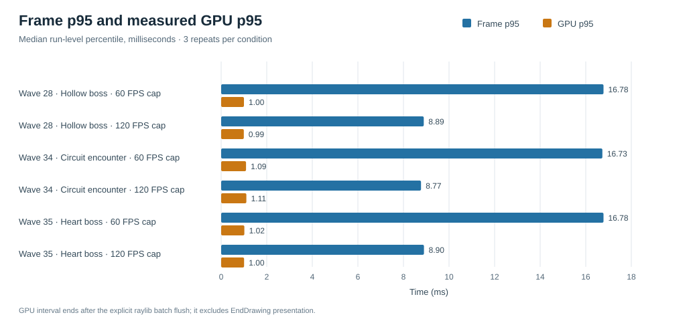

# ThreadLight late-game performance profile

## Findings

Across three 20-second repeats of each encounter and frame cap, the game rendered at **60.00–60.03 FPS** for the 60 cap and **118.39–119.16 FPS** for the 120 cap. At 120, median frame time was 8.34 ms, p95 was 8.77–8.90 ms, and p99 was 9.02–9.09 ms. Five frames across the nine 120-FPS runs exceeded 12.5 ms (1.5× the 8.33 ms target); no simulation time was discarded in any run.

The measured workload is **not CPU- or GPU-bound on this machine**. At the 120 cap, median GPU execution p95 was 0.99–1.11 ms, while update p95 was 0.075–0.082 ms, simulation p95 0.044–0.052 ms, and draw-submission p95 0.85–0.98 ms. `EndDrawing` occupied 7.57–7.73 ms at p50 and 8.19–8.29 ms at p95. That wall time includes the software limiter, OpenGL/driver, and presentation path; this run used a 60 Hz display, so it cannot establish 120 Hz physical presentation. The data point to frame pacing/waiting as the dominant cost, with a small 120-FPS shortfall, rather than simulation or GPU execution.

The process working set peaked at **203.7–205.1 MiB** across the capture sampler; private bytes peaked at **58.9–60.4 MiB** in the in-process sampler. The 200 MiB goal is therefore missed by up to 5.1 MiB if it means resident working set, and comfortably met if it means private memory. Private-memory growth over each 20-second capture was −0.1 to +0.8 MiB. Working-set growth was larger in runs whose first sample preceded startup warm-up; these short captures do not establish a leak or long-session growth rate.

## Measurements

The table shows the median of three run-level percentiles per condition. `EndDrawing` is CPU wall time and is not a GPU timing. GPU percentiles are asynchronous OpenGL `GL_TIME_ELAPSED` query results, attributed to their source frame; query results were available for at least 1,198 of about 1,200 frames at 60 FPS and 2,365 of about 2,380 at 120 FPS per condition.

| Encounter | Cap | Actual FPS (mean ± run SD) | Frame p50 / p95 / p99 (ms) | GPU p50 / p95 / p99 (ms) | Update / simulation / draw submit p95 (ms) | `EndDrawing` p50 / p95 (ms) | Worst frame (ms) | >12.5 ms frames | Sim time discarded |
|---|---:|---:|---:|---:|---:|---:|---:|---:|---:|
| Wave 28 Hollow boss | 60 | 60.00 ± 0.01 | 16.67 / 16.78 / 16.96 | 0.855 / 1.000 / 3.597 | 0.107 / 0.075 / 0.828 | 16.016 / 16.262 | 18.16 | 0 | 0 |
| Wave 28 Hollow boss | 120 | 118.43 ± 0.05 | 8.34 / 8.89 / 9.05 | 0.852 / 0.994 / 3.586 | 0.077 / 0.045 / 0.872 | 7.725 / 8.275 | 16.10 | 2 | 0 |
| Wave 34 Circuit encounter | 60 | 60.03 ± 0.01 | 16.67 / 16.73 / 16.87 | 0.928 / 1.092 / 1.507 | 0.107 / 0.075 / 0.876 | 15.923 / 16.213 | 18.37 | 0 | 0 |
| Wave 34 Circuit encounter | 120 | 119.16 ± 0.07 | 8.34 / 8.77 / 9.02 | 0.921 / 1.106 / 3.680 | 0.082 / 0.052 / 0.981 | 7.574 / 8.192 | 15.86 | 2 | 0 |
| Wave 35 Heart boss | 60 | 60.00 ± 0.00 | 16.67 / 16.78 / 16.97 | 0.790 / 1.019 / 3.476 | 0.101 / 0.067 / 0.770 | 16.031 / 16.260 | 17.75 | 0 | 0 |
| Wave 35 Heart boss | 120 | 118.39 ± 0.06 | 8.34 / 8.90 / 9.09 | 0.795 / 1.005 / 3.528 | 0.075 / 0.044 / 0.855 | 7.731 / 8.286 | 13.21 | 1 | 0 |



The heaviest tested workload was Wave 34: up to 19 simultaneous enemies, 60 active silk segments, 62 particles, 3 projectiles, and 3 ground hazards. The two boss fixtures peaked at 2 ordinary enemies and 2 boss hazards; Wave 35 reached 69 active silk segments and 47 particles. A separate seeded Wave 34 telemetry run confirmed echo creation/hits, cocoon formation, and a Crossweave pulse during the 20-second fixture. These are deterministic mixed-build fixtures with scripted movement and dash input, not a complete campaign playthrough.

### Bottlenecks ranked by measured impact

1. **Frame pacing and `EndDrawing` wait dominate elapsed frame time.** At 120 FPS the p50 wait was about 7.6–7.7 ms of an 8.34 ms median frame; at 60 FPS it was about 15.9–16.0 ms of a 16.67 ms frame. This includes limiter, driver and presentation behavior, so those components cannot be apportioned from these measurements.
2. **The 120 cap falls short of 120 FPS and has rare long frames.** All three encounters averaged 118.39–119.16 FPS. Five of roughly 21,400 captured frames at the 120 cap exceeded 12.5 ms. No simulation time was discarded, so these spikes did not trigger the fixed-step catch-up cap.
3. **Memory is close to, but above, a 200 MiB working-set goal.** The peak sampled working set was 203.7–205.1 MiB; private memory was only 58.9–60.4 MiB. Clarify which memory definition the product goal uses before setting an optimization target.
4. **No measured gameplay compute bottleneck surfaced on this hardware.** GPU p95 remained near 1 ms and CPU update/simulation/submission p95 remained below 1 ms individually. A slower CPU/GPU could change this conclusion; old hardware was not tested.

## Capture setup and limits

- Local `develop` baseline: `df21de9`; the diagnostic work is on `codex/late-game-performance-profile-20261027`. Relevant local source files were compared with the GitHub `develop` blobs before profiling; fetching the branch itself was unavailable in this environment.
- Hardware recorded for the machine: 12th-gen Intel Core i5-1235U, Intel Iris Xe Graphics (driver 32.0.101.5763), 12 logical processors, Windows 10 Pro Education build 26300, and a 60 Hz display.
- Window/framebuffer: 1280×800 logical window and 1920×1050 framebuffer; MSAA 4×; VSync requested off; software frame caps of 60 and 120. The display stayed at 60 Hz in both conditions.
- Each of the six encounter/cap conditions ran three 20-second captures from the mixed development build with seed 7382, scripted movement/dashes, audio disabled, and an isolated `APPDATA`. There are 18 primary CSV files. The separate CPU-only pre-query captures are retained in `cpu-only-baseline/` for comparison, not mixed into the tables.
- In-process memory was sampled once per second; the PowerShell process sampler checked working set and CPU about every 500 ms. These are sampled peaks, not continuous maxima. The GPU query starts before frame drawing and ends after an explicit raylib batch flush but before `EndDrawing`; it measures GPU execution for that interval and excludes physical presentation. Its ring polls availability before reading results and never blocks. A paired Wave 34 profiler-on/off spot check showed no increase in sampled process CPU time with profiling enabled, but the comparison was only one repeat per cap and is not a precise overhead estimate.
- PresentMon was not available locally. Existing checks and Windows GPU performance counters were unavailable for reliable OpenGL utilization, VRAM, queue, or displayed-frame attribution. PresentMon's OpenGL attribution limits therefore remain material: the GPU timer provides execution time, but this report cannot separate driver scheduling from compositor/display presentation or report GPU utilization/memory.
- `over_budget_frames` is intentionally not used as a stutter count: tiny timer jitter around the exact cap makes many frames exceed 8.333/16.667 ms. The reported spike rule is >1.5× the cap budget (12.5 ms at 120; 25 ms at 60). Frame timestamps are application loop intervals, not displayed-frame intervals.

## Recommendation

Do not optimize game simulation or visual effects from this evidence: they are not consuming the available frame budget on the tested system.

| Priority | Action | Expected benefit | Risk | Complexity |
|---|---|---|---|---|
| 1 | Repeat Wave 34 and boss runs on a true 120 Hz display and the oldest supported hardware; use a graphics trace that can separate OpenGL driver work from presentation. | Establish whether the ~1 FPS shortfall and five rare long frames occur on target hardware and are visible to players. | Requires access to the target display/hardware and reliable OpenGL tracing. | Low to medium |
| 2 | If the RAM goal means working set, audit warmed process assets and allocations; target at least 3.7–5.1 MiB lower than this run. | Bring resident memory below 200 MiB on the measured system if the reducible memory is found. | Trimming/releasing resources can trade memory for reloads, allocation churn, or visual quality. | Medium |
| 3 | Only if 120 Hz retests confirm the cap shortfall, investigate Windows timer/sleep and driver presentation pacing before changing the limiter. | The theoretical ceiling is about +0.8–1.6 FPS on these captures, plus steadier delivery if pacing is the cause. | Could add tearing, alter VSync/compositor behavior, or regress other refresh rates. | Medium |

If the target instead means private memory, current captures meet it with substantial margin. No optimization was implemented.

## Reproduction

From the `phase2-visuals-source` directory, build the diagnostic binary and run a cell with a new tag:

```powershell
& 'C:\Program Files\Microsoft Visual Studio\2022\Community\Common7\IDE\CommonExtensions\Microsoft\CMake\CMake\bin\cmake.exe' --build build-phase34-m7-msvc-x64 --config Release --target Threadlight ThreadlightPerformanceTests ThreadlightGameAudioTests -j 8
& .\profiling-results\run-boss-profile.ps1 -Wave 34 -Fps 120 -Tag wave34-circuit-120fps-r4
```

Use `-Wave 28` or `-Wave 35` for the Hollow and Heart bosses; `-Fps` accepts 60 or 120. For the full set, repeat runs 1–3 using the filenames in `capture-summary.csv`. The script refuses to overwrite a CSV. Rebuild the summaries with:

```powershell
& .\profiling-results\summarize-profile.ps1
& 'C:\Program Files\Microsoft Visual Studio\2022\Community\Common7\IDE\CommonExtensions\Microsoft\CMake\CMake\bin\ctest.exe' --test-dir build-phase34-m7-msvc-x64 -C Release --output-on-failure
```

The current test run passed **36/36 CTest tests**. The executable supports a CPU-logger run with GPU queries disabled by adding `--perf-no-gpu-timer`; for a no-logger baseline use the script's `-DisablePerfLog` switch.
